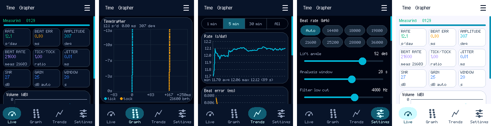

# TinyTimeGrapher

A header-only Arduino library that turns a microcontroller with a microphone and a touch display into a timegrapher for mechanical watches and clocks. It listens to the ticks, shows the key figures live and charts them over time.

This is the Arduino port of [Android-TimeGrapher](https://github.com/pschatzmann/Android-TimeGrapher). It uses [arduino-audio-tools](https://github.com/pschatzmann/arduino-audio-tools) for the audio and its filters, and [TinyMaterialDesign](https://github.com/pschatzmann/TinyMaterialDesign) for the GUI.



## Features

- **KPIs:** rate (s/day), beat error, amplitude, beat rate, tick/tock ratio, jitter and SNR.
- **Charts:** the standard timegrapher chart, a rolling volume chart with the detection threshold, and KPI trends (1 min / 5 min / 30 min / session).
- **Settings:** beat rate (auto or 14400 to 36000 bph), lift angle, analysis window, band-pass filter, automatic or manual gain, sensitivity, calibration offset, light/dark theme.
- **Clock correction with NTP** for a precise rate, with a WiFi page to select the network.
- **Menu:** Start / Stop, Reset session, WiFi, Light / Dark theme and Shut down.
- **Demo mode:** measures a simulated watch instead of the microphone.
- **Layered:** use only the measurement engine (any audio source, no display), or the complete touch GUI.
- **Extensible GUI:** each tab is its own class; add your own tabs with `addPage()` (see [Arduino API](https://github.com/pschatzmann/TinyTimeGrapher/wiki/Arduino-API#own-pages)).
- **Desktop build** with CMake: the GUI in an SDL2 window, the unit tests and a screenshot test of every page.

## Documentation

- [Example: ESP32-S3 2.8" Display](https://github.com/pschatzmann/TinyTimeGrapher/wiki/Example-ESP32-S3-Hosyond)
- [Arduino API](https://github.com/pschatzmann/TinyTimeGrapher/wiki/Arduino-API)
- [Tick, tock and amplitude](https://github.com/pschatzmann/TinyTimeGrapher/wiki/Tick-Tock-and-Amplitude)
- [Accuracy of the rate](https://github.com/pschatzmann/TinyTimeGrapher/wiki/Accuracy-of-the-Rate)
- [Desktop build](https://github.com/pschatzmann/TinyTimeGrapher/wiki/Desktop-Build)

## Installation in Arduino

You can download the library as zip and call include Library -> zip library. Or you can git clone this project into the Arduino libraries folder e.g. with

```
cd  ~/Documents/Arduino/libraries
git clone https://github.com/pschatzmann/TinyTimeGrapher.git
```

I recommend to use git because you can easily update to the latest version just by executing the git pull command in the project folder.

Install the dependencies the same way:

- [arduino-audio-tools](https://github.com/pschatzmann/arduino-audio-tools)
- [TinyMaterialDesign](https://github.com/pschatzmann/TinyMaterialDesign) (newer than v0.3.0: the current `main`) and [TinyGPU](https://github.com/pschatzmann/TinyGPU)
- [arduino-audio-driver](https://github.com/pschatzmann/arduino-audio-driver): for the codec of the example board
- [TinyNTP](https://github.com/pschatzmann/TinyNTP): optional, for the clock correction. It is licensed under the GPL v3.

## License

[MIT](LICENSE)
